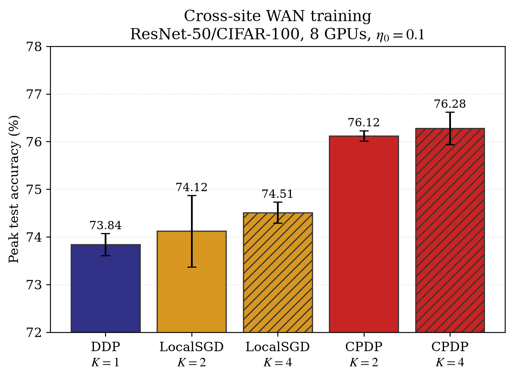
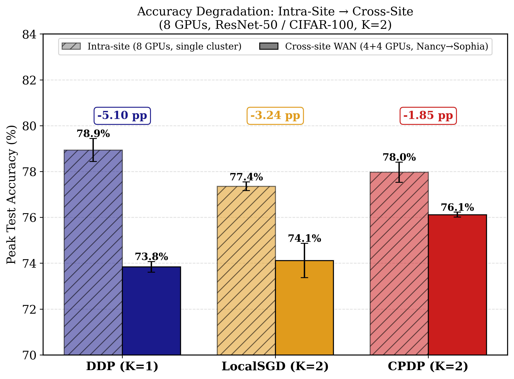
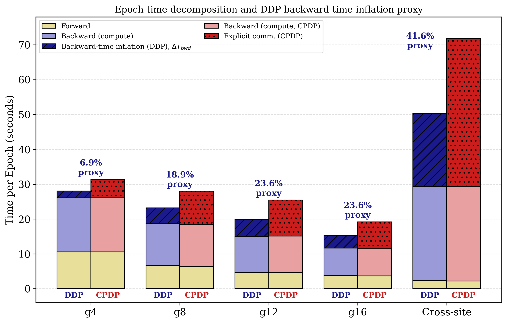

# Controlled Periodic Synchronization for Efficient Data-Parallel Training

Official PyTorch implementation and experimental configurations for the paper:

**Imane Ettifouri, Mostapha Zbakh, and Claude Tadonki**
**“Controlled Periodic Synchronization for Efficient Data-Parallel Training”**

**Accepted for publication in _Future Generation Computer Systems (FGCS)_.**

[**arXiv:2607.21224**](https://arxiv.org/abs/2607.21224)

Controlled Periodic Data Parallelism (**CPDP**) is a communication-aware distributed training strategy built on PyTorch DistributedDataParallel (DDP). CPDP reduces the frequency of global synchronization by alternating local optimization steps with periodic reconciliation that combines gradient synchronization, parameter averaging, and SlowMo correction.

The synchronization period \(K\) is treated as a configurable systems parameter, allowing communication frequency to be adapted to the underlying distributed environment. The paper evaluates this design on both intra-site GPU clusters and a real cross-site WAN deployment on Grid'5000.

---

## Overview

This repository provides:

- implementations of **DDP**, **LocalSGD**, and **CPDP**;
- experiment configurations corresponding to the paper;
- intra-site and cross-site distributed execution wrappers;
- communication profiling and diagnostic utilities;
- ResNet and ViT experimental configurations;
- reported paper results in CSV format;
- scripts for reproducing the main tables and figures.

The main experiments evaluate distributed training under different GPU counts, synchronization periods, learning rates, SlowMo coefficients, models, datasets, and network conditions.

---

## Synchronization Strategies

For an epoch containing \(T\) mini-batches and synchronization period \(K\), a periodic synchronization boundary occurs when

\[
t \bmod K = 0
\]

or at the final mini-batch of the epoch.

| Method | Gradient synchronization after warmup | Parameter reconciliation | SlowMo |
|---|---:|---:|---:|
| DDP | Every training step | No | No |
| LocalSGD | No | Every \(K\) steps | No |
| CPDP | Every \(K\) steps | Every \(K\) steps | Yes |

### DDP

DDP performs gradient synchronization at every training step using PyTorch `DistributedDataParallel`.

### LocalSGD

LocalSGD performs local optimization steps between synchronization boundaries. At each boundary, model parameters are averaged across workers.

### CPDP

CPDP performs local optimization between synchronization boundaries. At a synchronization boundary, it applies:

1. gradient synchronization;
2. the optimizer update;
3. parameter reconciliation across workers;
4. SlowMo outer-momentum correction.

During warmup, LocalSGD and CPDP use synchronous per-step gradient updates. Periodic parameter reconciliation and SlowMo are disabled during this phase.

Optimizer states, including SGD momentum buffers and AdamW moments, remain local and are not averaged during parameter reconciliation.

The principal CPDP experiments use a SlowMo coefficient of

\[
\beta = 0.3.
\]

---

## Main Results

### Cross-Site WAN Training

In the real cross-site WAN experiment, CPDP achieves the highest peak test
accuracy among the evaluated synchronization strategies using eight GPUs
distributed across the Nancy and Sophia Grid'5000 sites.

<p align="center">
  
</p>

<p align="center">
  <em>
  Peak test accuracy for DDP, LocalSGD, and CPDP on ResNet-50/CIFAR-100
  using eight GPUs in the cross-site WAN configuration.
  </em>
</p>

In this setting, CPDP reaches **76.12 ± 0.11%** for \(K=2\) and
**76.28 ± 0.34%** for \(K=4\), compared with **73.84 ± 0.23%** for DDP,
**74.12 ± 0.75%** for LocalSGD \(K=2\), and **74.51 ± 0.22%** for
LocalSGD \(K=4\).

### Robustness to Cross-Site Training

The comparison between the eight-GPU intra-site and cross-site configurations
shows different reductions in peak test accuracy across the evaluated
synchronization strategies.

<p align="center">
  
</p>

<p align="center">
  <em>
  Peak test accuracy difference between the eight-GPU intra-site and cross-site
  configurations.
  </em>
</p>

CPDP exhibits the smallest observed difference at **1.85 percentage points**,
compared with **3.24 pp** for LocalSGD and **5.10 pp** for DDP. This comparison
should not be interpreted as isolating the causal effect of WAN execution alone,
because the intra-site and cross-site experiments also differ in learning-rate
and batch-size settings. The values therefore characterize the overall change
between the evaluated configurations rather than a controlled network-only
intervention.

### Communication Behavior

The profiling experiments characterize the communication cost exposed during
distributed execution and show how communication becomes increasingly important
as the execution environment scales from intra-site to cross-site training.

<p align="center">
  
</p>

<p align="center">
  <em>
  Epoch-time decomposition and DDP backward-time inflation proxy across
  intra-site and cross-site configurations.
  </em>
</p>

In the cross-site configuration, the DDP backward-time inflation proxy reaches
**41.6%**, highlighting the increased influence of communication on synchronous
training over the WAN.

---

## Repository Structure

```text
CPDP-Distributed-Training/
├── configs/
│   ├── beta_sweep/
│   ├── intra_site/
│   ├── k_sweep/
│   ├── tinyimagenet/
│   ├── vit/
│   └── wan/
│
├── docs/
│   ├── figures/
│   │   ├── appendix/
│   │   │   ├── fig3_curves_g8.png
│   │   │   ├── fig4_curves_g16.png
│   │   │   ├── fig10_vit_scaling.png
│   │   │   ├── fig11_tinyimagenet_scaling.png
│   │   │   ├── fig13_multiscale_curves.png
│   │   │   ├── fig14_comm_ratio.png
│   │   │   ├── fig15_acc_vs_time_g8.png
│   │   │   ├── fig16_crosssite_acc_vs_time.png
│   │   │   ├── fig17_vit_curves_g4.png
│   │   │   └── fig18_tinyimagenet_curves_g12.png
│   │   ├── figB_crosssite_degradation.png
│   │   ├── figC_backward_inflation.png
│   │   └── figD_crosssite_kcompare.png
│   ├── appendix.md
│   ├── grid5000_reproduction.md
│   ├── profiling.md
│   └── reproducibility.md
│
├── plotting/
│   └── plot_figures.py
│
├── results/
│   └── paper_summary/
│
├── scripts/
│   ├── environment_report.py
│   ├── launch.py
│   ├── prepare_cifar.py
│   ├── reproduce_figure1.sh
│   ├── reproduce_figure2.sh
│   ├── reproduce_figure3.sh
│   ├── reproduce_figure4.sh
│   ├── reproduce_table5_wan.sh
│   ├── reproduce_table8_wan_profile.sh
│   ├── reproduce_table9_intra_profile.sh
│   ├── reproduce_table10_scaling.sh
│   ├── reproduce_table12_lr_sensitivity.sh
│   ├── reproduce_table13_vit.sh
│   ├── reproduce_table14_tinyimagenet.sh
│   ├── reproduce_table15_k_sweep.sh
│   ├── reproduce_table16_beta_sweep.sh
│   └── summarize_runs.py
│
├── src/
│   ├── diagnostics.py
│   ├── profile_comm.py
│   ├── schedule.py
│   ├── slowmo.py
│   ├── synchronization.py
│   └── train_scaling.py
│
├── tests/
│   └── test_release.py
│
├── CITATION.cff
├── environment.yml
├── LICENSE
├── requirements.txt
└── README.md
```

---

## Requirements

The software environment reported in the paper is:

| Component | Version |
|---|---|
| Python | 3.9 |
| PyTorch | 2.4 |
| torchvision | 0.19 |
| CUDA | 11.8 |
| NCCL | 2.18 |

Linux/CUDA compute nodes are the primary execution environment.

---

## Installation

Clone the repository:

```bash
git clone https://github.com/EmyEtti/CPDP-Distributed-Training.git
cd CPDP-Distributed-Training
```

Create the provided Conda environment:

```bash
conda env create -f environment.yml
conda activate cpdp-fgcs
```

Alternatively, create a Python 3.9 environment and install the dependencies manually:

```bash
python -m pip install \
    'torch>=2.4,<2.5' \
    'torchvision>=0.19,<0.20' \
    --index-url https://download.pytorch.org/whl/cu118

python -m pip install -r requirements.txt
```

The installed runtime environment can be inspected using:

```bash
python scripts/environment_report.py
```

---

## Datasets

### CIFAR-100

Prepare CIFAR-100 using:

```bash
python scripts/prepare_cifar.py --data-root /path/to/data
```

The training code expects the dataset to be prepared explicitly before launching distributed experiments.

### TinyImageNet

TinyImageNet is not redistributed with this repository.

The expected structure is:

```text
tiny-imagenet-200/
├── train/
│   └── <class>/
│       └── ...
└── val/
    └── <class>/
        └── ...
```

The official validation images should be organized into class directories using `val_annotations.txt`.

---

## Reproducing the Paper Experiments

Experiment configurations are stored under:

```text
configs/
```

The reproduction wrappers print the distributed-training commands by default. Experiments are launched only when execution is explicitly enabled.

### Cross-Site WAN Experiments

Display the commands corresponding to the main WAN experiment:

```bash
bash scripts/reproduce_table5_wan.sh
```

For example, to execute CPDP with \(K=4\) and seed 42:

```bash
bash scripts/reproduce_table5_wan.sh \
    --experiment cpdp_K4 \
    --seed 42 \
    --execute
```

For multi-node execution, `MASTER_ADDR` and `NODE_RANK` must be configured consistently on all allocated nodes.

Detailed Grid'5000 instructions are available in:

[`docs/grid5000_reproduction.md`](docs/grid5000_reproduction.md)

### Intra-Site Scaling

For example:

```bash
bash scripts/reproduce_table10_scaling.sh \
    --experiment g4_ddp \
    --seed 42
```

Additional wrappers reproduce the experiments associated with:

- WAN communication profiling;
- intra-site communication profiling;
- multi-GPU scaling;
- learning-rate sensitivity;
- ViT-S experiments;
- TinyImageNet experiments;
- synchronization-period sensitivity;
- SlowMo coefficient sensitivity.

---

## Main Cross-Site WAN Results

The principal WAN experiment uses eight GPUs distributed across two Grid'5000 sites, with four GPUs in Nancy and four GPUs in Sophia.

| Method | \(K\) | Peak Test Accuracy (%) | Training Time (s) |
|---|---:|---:|---:|
| DDP | 1 | 73.84 ± 0.23 | 4959 ± 65 |
| LocalSGD | 2 | 74.12 ± 0.75 | 6922 ± 65 |
| LocalSGD | 4 | 74.51 ± 0.22 | 4170 ± 41 |
| CPDP | 2 | **76.12 ± 0.11** | 7203 ± 129 |
| CPDP | 4 | **76.28 ± 0.34** | **4275 ± 59** |

These results correspond to the fixed learning-rate WAN evaluation reported in the paper.

The reported values are stored in:

```text
results/paper_summary/table5.csv
```

---

## Reported Results

The directory

```text
results/paper_summary/
```

contains the numerical values reported in the paper.

It includes results corresponding to Tables:

- Table 5: cross-site WAN comparison;
- Table 8: WAN communication profiling;
- Table 9: intra-site profiling;
- Table 10: multi-GPU scaling;
- Table 12: learning-rate sensitivity;
- Table 13: ViT-S experiments;
- Table 14: TinyImageNet experiments;
- Table 15: synchronization-period analysis;
- Table 16: SlowMo coefficient sensitivity.

These values are kept separate from newly generated experimental outputs.

New experiment runs are written under:

```text
results/new_runs/
```

---

## Reproducing the Figures

The figures displayed in the Main Results section correspond to the final figures
used in the paper. The following plotting scripts rebuild reproducible
visualizations directly from the reported CSV values:

```bash
bash scripts/reproduce_figure1.sh
bash scripts/reproduce_figure2.sh
bash scripts/reproduce_figure3.sh
bash scripts/reproduce_figure4.sh
```

The generated files are written to:

```text
results/figures/
```

in both PNG and PDF formats.

The plotting implementation is located in:

```text
plotting/plot_figures.py
```

---

## Profiling and Diagnostics

Communication profiling is implemented in:

```text
src/profile_comm.py
```

The profiling experiments measure synchronization overhead and communication-related timing effects under both intra-site and cross-site execution.

Detailed information is provided in:

[`docs/profiling.md`](docs/profiling.md)

Optional parameter-drift diagnostics can be enabled for direct training commands with:

```text
--enable-drift-diagnostics
```

These diagnostics are disabled in the paper reproduction configurations.

---

## Output Files

New training runs produce experiment outputs under:

```text
results/new_runs/
```

Each run records:

```text
metrics.csv
run_info.json
```

Multiple runs can be aggregated using:

```bash
python scripts/summarize_runs.py \
    --input-root results/new_runs/table5 \
    --output results/new_runs/table5_summary.csv
```

Reported paper values under `results/paper_summary/` are kept separate from newly generated runs.

---

## Testing

Run the repository test suite with:

```bash
python -m unittest discover -s tests -v
```

The tests cover:

- synchronization scheduling;
- warmup behavior;
- gradient synchronization;
- periodic parameter reconciliation;
- SlowMo state handling;
- optimizer-state preservation;
- distributed behavior using CPU/Gloo processes.

Full GPU/NCCL performance experiments require allocated GPU resources.

---

## Additional Results

Supplementary convergence curves, accuracy–time analyses, communication results,
and additional workload evaluations are available in
[`docs/appendix.md`](docs/appendix.md).

These results complement the main paper and are provided for additional
reproducibility and transparency.

---

## Reproducibility

Additional information about implementation semantics, experimental configurations, software versions, and reproduction procedures is available in:

[`docs/reproducibility.md`](docs/reproducibility.md)

---

## Citation

The paper has been **accepted for publication in _Future Generation Computer Systems (FGCS)_**.

Until the final journal DOI, volume, issue, and page information are available, please cite the arXiv version:

```bibtex
@article{ettifouri2026controlled,
  title   = {Controlled Periodic Synchronization for Efficient Data-Parallel Training},
  author  = {Ettifouri, Imane and Zbakh, Mostapha and Tadonki, Claude},
  journal = {arXiv preprint arXiv:2607.21224},
  year    = {2026}
}
```

Preprint:

**https://arxiv.org/abs/2607.21224**

The citation information will be updated with the final FGCS bibliographic record once it becomes available.

---

## License

This project is released under the MIT License.

See [`LICENSE`](LICENSE) for details.
