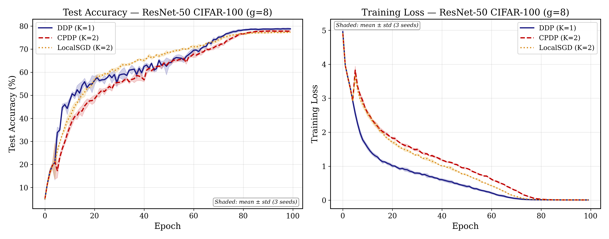
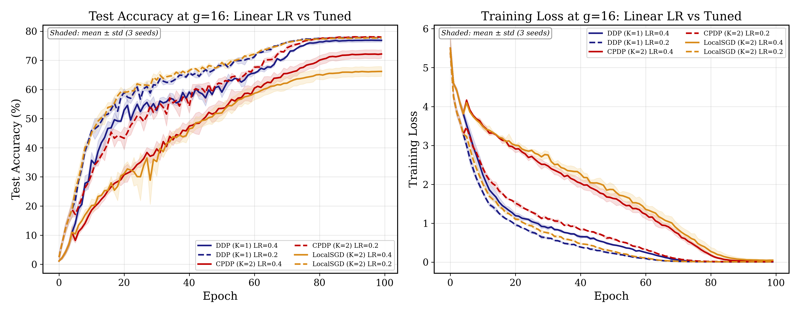
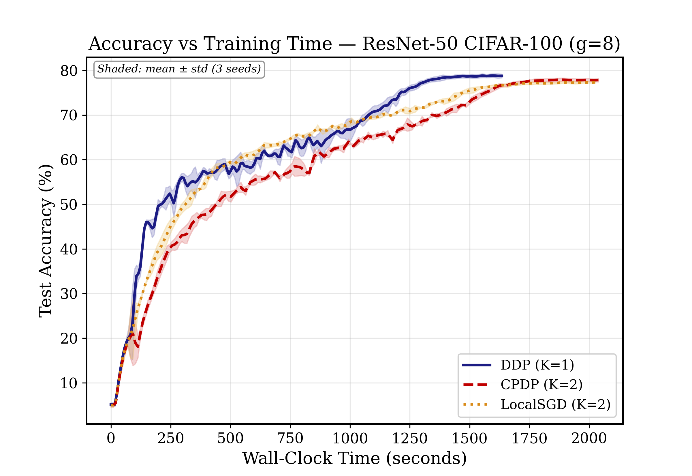
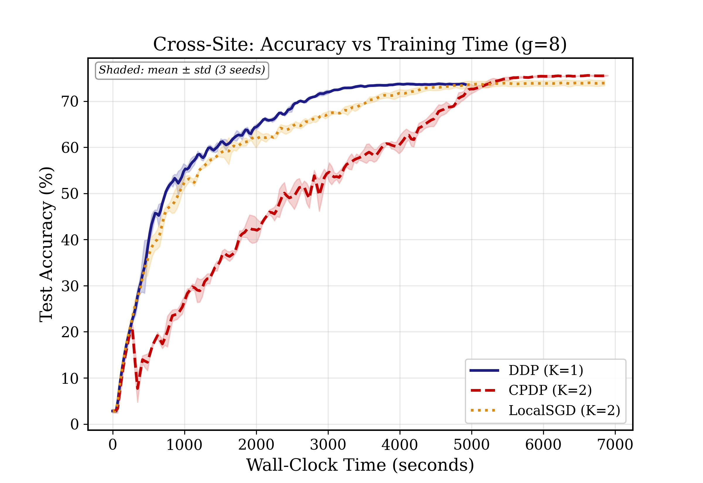
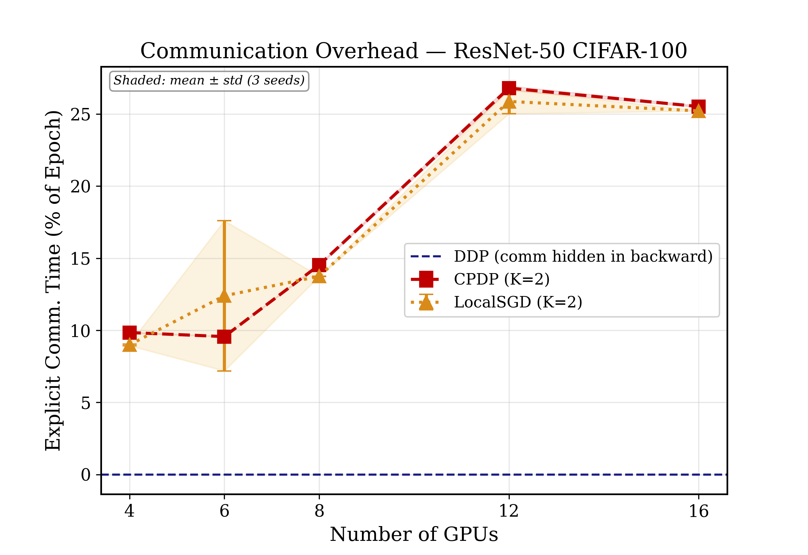
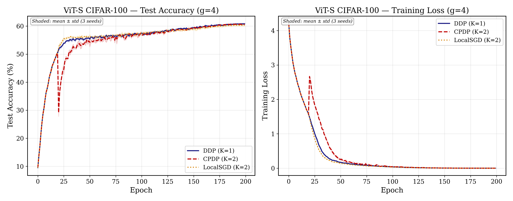
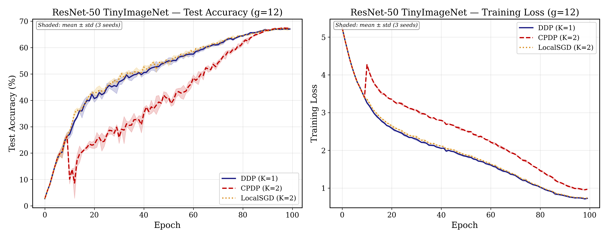
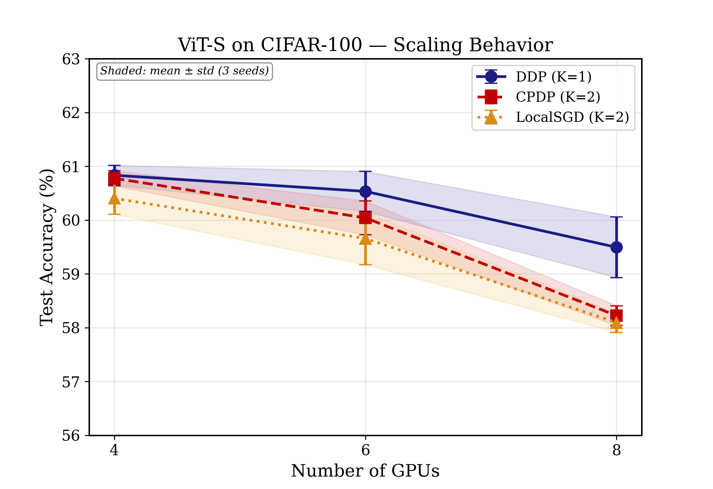
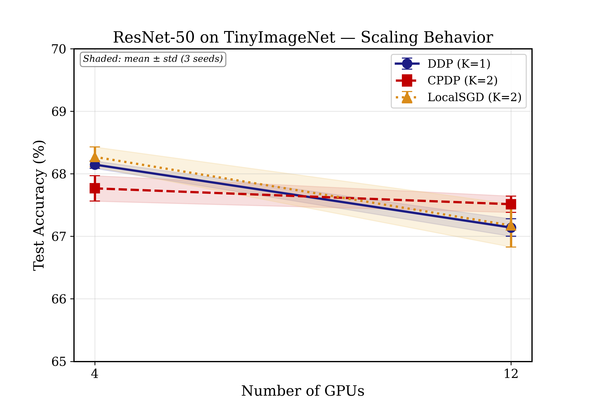
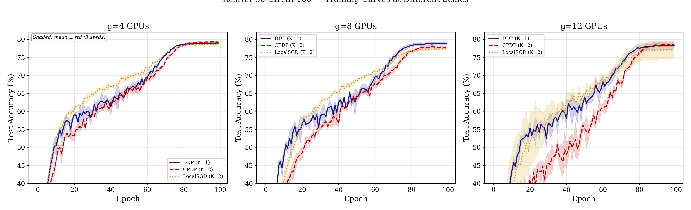

# Additional Experimental Results

This document provides supplementary experimental results for the paper
**“Controlled Periodic Synchronization for Efficient Data-Parallel Training.”**

These figures complement the experiments reported in the main paper by providing
additional views of convergence behavior, accuracy–time trade-offs, communication
overhead, scaling behavior, and performance across additional workloads.

They are provided here for reproducibility and transparency. Some of these
results may not appear in the final journal version because of space constraints.

---

## 1. Training Convergence

### ResNet-50 / CIFAR-100 — 8 GPUs

The following figure shows the complete convergence behavior of DDP, LocalSGD,
and CPDP for ResNet-50 on CIFAR-100 using eight GPUs. The curves represent the
mean test accuracy across three independent runs, with shaded regions indicating
the standard deviation.

  

  <em>
  Training convergence for ResNet-50/CIFAR-100 at 8 GPUs. Shaded regions
  represent mean ± standard deviation across three seeds.
  </em>

At this scale, all three strategies converge successfully. DDP achieves the
highest peak accuracy, while CPDP remains consistently above LocalSGD during
training.

### ResNet-50 / CIFAR-100 — 16 GPUs

At 16 GPUs, the effect of aggressive large-batch learning-rate scaling becomes
more visible.

  

  <em>
  Training convergence for ResNet-50/CIFAR-100 at 16 GPUs.
  </em>

LocalSGD exhibits substantial optimization degradation under the corresponding
learning-rate scaling configuration, whereas CPDP maintains a more stable
trajectory. DDP remains the most stable strategy in this setting.

---

## 2. Accuracy–Training-Time Trade-Off

### Intra-Site — 8 GPUs

The next figure provides a qualitative view of test accuracy as a function of
wall-clock training time for the eight-GPU configuration.

  

  <em>
  Test accuracy versus wall-clock training time for ResNet-50/CIFAR-100
  using 8 GPUs.
  </em>

The figure complements the numerical results reported in the main paper by
showing the evolution of the accuracy–time trade-off throughout training.

### Cross-Site WAN

The same relationship is shown below for the real cross-site WAN configuration.

  

  <em>
  Test accuracy versus training time for the cross-site WAN experiment.
  </em>

The trajectories illustrate the stronger influence of communication latency on
fully synchronous training and provide an additional view of the behavior of
periodic synchronization under WAN conditions.

---

## 3. Communication Analysis

The estimated communication ratio increases as distributed execution scales
from smaller intra-site configurations toward the cross-site WAN environment.

  

  <em>
  Estimated communication-related fraction of training time across different
  distributed configurations.
  </em>

This trend complements the communication profiling results reported in the main
paper and helps explain why synchronization frequency becomes an increasingly
important systems parameter as communication costs increase.

---

## 4. Additional Workloads

### ViT-S / CIFAR-100 Convergence

The following figure shows training behavior for ViT-S on CIFAR-100 using four
GPUs.

  

  <em>
  Training curves for ViT-S/CIFAR-100 using 4 GPUs.
  </em>

The relative ordering remains consistent with the corresponding quantitative
evaluation: DDP achieves the highest accuracy, while CPDP improves upon
LocalSGD and maintains stable convergence.

### ResNet-50 / TinyImageNet Convergence

The next figure shows the corresponding convergence behavior for ResNet-50 on
TinyImageNet using 12 GPUs.

  

  <em>
  Training curves for ResNet-50/TinyImageNet using 12 GPUs.
  </em>

The three synchronization strategies exhibit similar behavior during the early
training phase, while CPDP maintains stable optimization as distributed scale
increases.

---

## 5. Additional Scaling Results

### ViT-S Scaling

  

  <em>
  Additional ViT-S scaling results across the evaluated distributed
  configurations.
  </em>

### TinyImageNet Scaling

  

  <em>
  Additional ResNet-50/TinyImageNet scaling results.
  </em>

### Multi-Scale Convergence

The following consolidated view compares training behavior across multiple
distributed scales.

  

  <em>
  Consolidated convergence behavior across multiple distributed training
  scales.
  </em>

These supplementary results provide additional context for the scaling trends
reported in the main paper.

---

## Reproducibility

The experimental configurations corresponding to the reported evaluations are
available under [`../configs/`](../configs/).

The main reproduction instructions are provided in:

- [`reproducibility.md`](reproducibility.md)
- [`grid5000_reproduction.md`](grid5000_reproduction.md)
- [`profiling.md`](profiling.md)

The numerical results reported in the paper are available under
[`../results/paper_summary/`](../results/paper_summary/).
